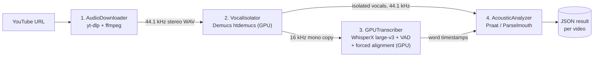

<div align="center">

# 🎙️ ytspeechpipeline

**Turn a YouTube video into a word-level transcript enriched with prosodic features, so child-directed speech can be compared with adult-directed speech.**


</div>

---

## 🎬 Demo

https://github.com/user-attachments/assets/29e0c71e-328e-44f0-8037-707e23787a7b

*Pipeline output played back over the original audio. Words light up at their WhisperX-aligned times, syllables at their estimated times, and the bottom row shows the pitch, pause and speech rate measured for the current word. Rendered with [`tools/render_karaoke_video.py`](tools/render_karaoke_video.py).*

<sub>Audio: [“How CRISPR lets you edit DNA” by Andrea M. Henle, TED-Ed](https://www.youtube.com/watch?v=6tw_JVz_IEc), licensed CC BY-NC-ND 4.0. First 60 seconds, used for non-commercial research demonstration.</sub>

---

## What is it?

When adults talk to children they change the way they speak: higher and more variable pitch, slower speech, longer pauses. Linguists call this **child-directed speech (CDS)**, as opposed to **adult-directed speech (ADS)**.

This project is the data pipeline behind my bachelor's thesis, which measures those differences on real-world audio. It takes public YouTube videos from two groups:

- **`kids`**: content made for children (YouTube Kids-style channels: songs, stories, educational shows)
- **`normal`**: regular English YouTube content aimed at adults

For every spoken word it produces exact timestamps plus acoustic measurements (pitch, pitch variance, pause length and speech rate), ready for statistical comparison.

---

## How it works



| Stage | Tool | What it does |
|---|---|---|
| **1. Download** | `yt-dlp`, `ffmpeg` | Fetches the audio stream and decodes it to 44.1 kHz stereo WAV. Bundles Deno + `yt-dlp-ejs` so public videos work without API keys. |
| **2. Vocal isolation** | Demucs `htdemucs` | Removes background music and effects, which kids' content is full of. VRAM use is bounded so long videos don't run out of memory. |
| **3. Transcription & alignment** | WhisperX `large-v3`, Silero VAD | Transcribes the isolated vocals, then forced-aligns every word to get precise start and end times. |
| **4. Acoustic analysis** | Praat via Parselmouth | Computes mean F0 (pitch), F0 variance, the pause after each word and speech rate (syllables per second). |

**A note on sample rates.** `htdemucs` is trained on 44.1 kHz stereo, and feeding it 16 kHz mono noticeably degrades separation. The pipeline therefore:

1. runs Demucs at 44.1 kHz stereo;
2. keeps the isolated vocals at 44.1 kHz for pitch analysis, which gives a finer F0 grid;
3. creates a 16 kHz mono copy **only** for WhisperX.

All acoustic analysis runs on the isolated vocals, never on the raw mix.

---

## Output

Each processed video becomes one JSON file in `results/<label>/`. Granularity can be `word`, `syllable` or `both`:

```json
{
  "label": "kids",
  "source_url": "https://www.youtube.com/watch?v=ecngECYO5ZI",
  "language": "en",
  "granularity": "both",
  "words": [
    {
      "word": "doctor",
      "start_time": 16.883,
      "end_time": 17.504,
      "pitch_mean_hz": 287.34,
      "pitch_variance": 78.32,
      "pause_after_sec": 0.12,
      "speech_rate_sps": 3.221
    }
  ]
}
```

At `syllable` granularity, every aligned word is also split into syllables with their own timing and pitch values. The [`results/`](results/) folder contains about 200 sample outputs (100 `kids` and 98 `normal`).

---

## Quick start

### 1. Run on one video

```bash
# Install a CUDA build of PyTorch first (see requirements.txt), then:
pip install -r requirements.txt

python speech_pipeline.py "https://youtu.be/XXXX" --out result.json --label kids --granularity both

# Exaggerated child-directed speech can go very high, so raise the pitch ceiling:
python speech_pipeline.py "https://youtu.be/XXXX" --pitch-ceiling 800
```

`ffmpeg` must be installed as a system binary.

### 2. Run as an API (Docker)

The image bakes in all model weights. WhisperX runs on one GPU, and Demucs plus forced alignment run on a second GPU.

```bash
cp .env.example .env          # choose the GPU IDs
docker compose build
mkdir -p results _batch_work
docker compose up -d yt-transcriber-api
```

| Endpoint | Description |
|---|---|
| `GET /health` | Readiness and the GPU device in use |
| `POST /v1/jobs` | Queue a video: `{"url": "...", "label": "kids", "granularity": "both"}` |
| `GET /v1/jobs` | List jobs |
| `GET /v1/jobs/{id}` | Job status and per-stage progress |
| `GET /v1/jobs/{id}/result` | The finished JSON result |

Interactive docs are available at `/docs`. Job state is kept in a local JSON store, so no database is needed. See [DOCKER.md](DOCKER.md) for running it behind Traefik.

### 3. Batch processing on a multi-GPU server

`batch_pipeline.py` processes a labelled URL list and can resume where it stopped. Each worker takes a deterministic round-robin shard and keeps its own checkpoint file, so workers never overwrite each other and a crash simply continues from the last finished video.

```bash
python batch_pipeline.py videos.txt --shard-count 8 --shard-index 0 --granularity both
```

[`compose.bengee.yaml`](compose.bengee.yaml) runs **8 workers on 4× A100 40 GB** (two per GPU) over a 2,000-video manifest. [BENGEE.md](BENGEE.md) covers GPU mapping, memory tuning and YouTube cookies.

---

## Building the dataset

The collection scripts **never download media**. They only gather and verify metadata:

| Script | Purpose |
|---|---|
| `collect_youtube_manifest.py` | Searches child-directed channels and queries (songs, stories, PBS Kids-style shows) and adult content for English videos 5–10 minutes long |
| `build_verified_video_manifest.py` | Keeps only videos whose audio can be extracted without signing in |
| `collect_fast_verified_manifest.py`, `run_parallel_collection.py` | Faster, parallel variants of the above |

The final selection, 1,000 `kids` and 1,000 `normal` videos, is in [`artifacts/`](artifacts/).

---

## Testing

```bash
python smoke_test.py            # CPU-only: validates the pitch and syllable math on a synthetic signal
python smoke_test.py --heavy    # also runs Demucs and WhisperX if they are installed
pytest                          # batch sharding, checkpoints, cookies, transcriber cache, Demucs memory
```

---

## Repository layout

```
speech_pipeline.py       Core pipeline: download → isolate → transcribe/align → analyze
batch_pipeline.py        Resumable, sharded batch runner
yt_transcriber_api.py    FastAPI job service
download_models.py       Pre-downloads model weights into the Docker image
collect_*.py, build_*    Dataset discovery and verification (metadata only)
compose*.yaml            Single-server and 4-GPU deployments
results/                 Sample outputs (one JSON per video)
artifacts/               Video manifests
```

---

## Limitations

- **Syllables are estimated.** Boundaries come from an English orthographic heuristic applied inside each aligned word, not from phoneme-level forced alignment.
- **Labels describe the audience, not the speaker.** `kids` and `normal` say who a video is made for. They are not utterance-level CDS/ADS annotations, so they are treated as a proxy in the analysis.
- **The source is noisy.** YouTube audio contains music, sound effects and several speakers. Demucs reduces this but does not remove it completely.
